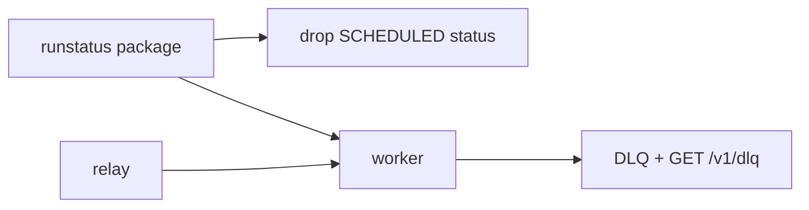

# Plan: close lifecycle gap, clarify run status, single source of truth

This plan addresses the three risks called out in the state-machine audit:
missing runtime components for terminal run states, the unused `SCHEDULED` run
status name, and duplicated run-status literals across migration, API, and sqlc.

**Non-goals for this plan:** RabbitMQ topology design beyond “relay publishes
`JOB_DISPATCH` JSON”; UI; changing cancel HTTP semantics; `JOB_CANCEL` outbox
events (optional later per `docs/cancellation.md`).

**Reference docs today:** `docs/state-machines.md`, `docs/cancellation.md`,
`docs/future-endpoints.md`, `internal/api/status.go`,
`internal/database/sqlc/queries/job_runs.sql`.

---

## Principles

1. **Schema states must have an owner in-repo** — either a binary (`cmd/*`) or
   drop the value from the constraint if it will never be written.
2. **Transitions live in sqlc SQL** — new lifecycle moves are named queries with
   conditional `WHERE status = ...` (same pattern as `CancelRun`,
   `ClaimRunToRunning`).
3. **Go constants for API and validation only** — SQL stays literal; a test
   guards drift (see Phase A).
4. **One migration per coherent schema change** — goose up/down; no editing
   `00001` after it has shipped anywhere that matters.
5. **Integration tests** — each new binary gets Postgres tests under `TEST_DATABASE_URL`
   like `cmd/schedular` and `test/api`.

---

## Phase ordering

| Phase | Delivers | Depends on |
| --- | --- | --- |
| **A** | `internal/runstatus` + drift test; API uses package | — |
| **B** | Remove dead `SCHEDULED` run status from DB + callers | A (constants list) |
| **C** | Outbox relay (`cmd/relay`) → `PUBLISHED` | — (can parallel A) |
| **D** | Worker (`cmd/worker`) → claim, heartbeat, terminals, `RETRY_WAIT` | A, C (dispatch path) |
| **E** | DLQ producer + read API | D |

---

## Phase A — Single run-status registry in Go

**Problem:** `internal/api/status.go`, migration `CHECK`, and sqlc strings can diverge when the worker lands.

**Work**

1. Add `internal/runstatus` with:
   - Exported constants for every persisted `job_runs.status` value.
   - `All() []string`, `Valid(string) bool`, `Terminal(string) bool`,
     `Claimable(string) bool` (mirror claim/cancel guards).
   - Cancellation dispositions stay in `internal/api` but key off `runstatus`
     constants (move map from raw strings to constants only).
2. Replace literals in `internal/api` (`status.go`, validation, tests) with
   `runstatus.*`.
3. Add `test/runstatus/sqlc_literals_test.go` (or `internal/runstatus/sqlc_test.go`):
   - Parse `internal/database/sqlc/queries/job_runs.sql` (and any new worker
     query files) for quoted status tokens.
   - Assert every token is in `runstatus.All()` and every **writable** status
     appears in at least one transition query (optional allowlist for
     terminal-only states set only by worker queries).

**Done when:** `go test ./...` passes; API has no raw run-status strings except
re-exports if desired.

**Ongoing rule:** New transition = new sqlc query + update drift test allowlist.

---

## Phase B — Remove misleading `SCHEDULED` **run** status

**Problem:** `trigger_source = 'SCHEDULED'` is real; `job_runs.status = 'SCHEDULED'` is never written but appears in CHECK, indexes, claim/cancel SQL, and API filters.

**Clarification (document in migration comment + `docs/state-machines.md`):**

| Field | Meaning |
| --- | --- |
| `trigger_source = 'SCHEDULED'` | Run created by scheduler (keep). |
| `status = 'QUEUED'` | Run is waiting to be claimed (keep). |
| ~~`status = 'SCHEDULED'`~~ | Removed — was a reserved name with no writer. |

**Work**

1. Migration `00004_drop_scheduled_run_status.sql`:
   - `UPDATE job_runs SET status = 'QUEUED' WHERE status = 'SCHEDULED'` (no-op
     in empty DB; safe if legacy rows exist).
   - Replace `job_runs.status` CHECK to omit `SCHEDULED`.
   - Drop partial index `job_runs_scheduled_for_idx` (predicate
     `WHERE status = 'SCHEDULED'`).
2. sqlc: remove `'SCHEDULED'` from `ClaimRunToRunning` and `CancelRun` `IN (...)`
   lists; `sqlc generate`.
3. `internal/runstatus`: remove `Scheduled` constant; API drop from filter
   validation and README tables.
4. Update `docs/state-machines.md`, `docs/cancellation.md`,
   `internal/api/README.md`, audit diagram.

**Done when:** grep shows no `SCHEDULED` in run **status** context except
`trigger_source` and comments; integration tests still pass.

**Risk:** External clients filtering `status=SCHEDULED` — treat as API breaking;
note in changelog; value was never observable on new rows.

---

## Phase C — Outbox relay (`cmd/relay`)

**Problem:** Only `PENDING` `JOB_DISPATCH` rows are inserted; `INFLIGHT` / `PUBLISHED` are schema-only.

**Work**

1. **sqlc queries** (`internal/database/sqlc/queries/outbox.sql`):
   - `ClaimOutboxBatch` — `FOR UPDATE SKIP LOCKED`, `status = 'PENDING'` and
     `available_at <= now()`, set `INFLIGHT`, `locked_by`, `locked_until`.
   - `CompleteOutboxPublish` — `INFLIGHT` → `PUBLISHED`, `published_at`, clear lock.
   - `ReleaseOutboxClaim` — `INFLIGHT` → `PENDING`, bump `publish_attempts`,
     set `available_at` backoff, `last_error` (expired lock recovery).
2. **`internal/config`** — `RELAY_*` env (interval, batch, lock TTL, shutdown
   grace, RabbitMQ URL, exchange/routing key) mirroring scheduler pattern.
3. **`cmd/relay/main.go`** — poll loop:
   - Claim batch in txn → publish each message (body already
     `{"run_id":"..."}`) → mark `PUBLISHED` per row or release on failure.
   - Stale `INFLIGHT` with `locked_until < now()` reclaimed by claim query.
4. **Compose / README** — document RabbitMQ as optional dev dependency; relay
   fails health if broker unreachable (or degrade with clear logs — pick one and
   document).
5. **Tests** — integration: insert `PENDING` outbox, run relay hook or test
   `Queries` sequence without real AMQP (inject `Publisher` interface).

**Done when:** scheduler or manual trigger → relay → `PUBLISHED` in Postgres;
message observable on broker in manual dev check.

**Defer:** `JOB_CANCEL` outbox rows; relay publishes dispatch only first.

---

## Phase D — Worker (`cmd/worker`)

**Problem:** No in-repo owner for `RUNNING` → `SUCCEEDED` / `FAILED` / `RETRY_WAIT` /
`CANCELLED`, or lease/heartbeat fields.

**Work**

1. **sqlc queries** (`job_runs.sql` or `worker.sql`):
   - `ListClaimableRuns` or worker calls existing pattern: `GetJobForUpdate` +
     `ClaimRunToRunning` (set `lease_expires_at`, `worker_id`, `attempt_count`
     rules per product).
   - `HeartbeatRun` — extend lease when `status IN ('RUNNING','CANCEL_REQUESTED')`
     and `worker_id` + `fencing_token` match (add increment on claim if not
     already set).
   - `CompleteRunSucceeded` / `CompleteRunFailed` — conditional on `id`, `status`,
     `worker_id`, `fencing_token`; set `finished_at`, `result` / `last_error`,
     `exit_code`.
   - `ScheduleRunRetry` — `RUNNING` or post-failure → `RETRY_WAIT`, set
     `retry_at`, `attempt_count`++, respect `max_attempts` on job/run snapshot.
   - `CompleteRunCancelled` — from `CANCEL_REQUESTED` or cooperative stop per
     `docs/cancellation.md` (conditional update; do not overwrite terminal).
2. **Dispatch intake:** MVP choices (document in worker README):
   - **Option 1 (recommended):** RabbitMQ consumer subscribed to same routing as
     relay; message is run ID only; worker loads run from DB.
   - **Option 2:** DB poll on `QUEUED` (bypasses outbox) — only if relay is
     skipped; not recommended once relay exists.
3. **`cmd/worker/main.go`** — consumer loop + per-run handler registry (stub
   handler that sleeps/returns error for tests); lease renewal ticker; graceful
   shutdown waits for in-flight handlers.
4. **Config** — `WORKER_*` (consumer prefetch, lease duration, heartbeat interval,
   shutdown grace).
5. **Tests** — integration: insert `QUEUED` run → claim → succeed/fail/retry/cancel
   paths; assert status counts and lease expiry behavior align with
   `JobHasBusyRun`.

**Done when:** end-to-end in dev: create job → trigger or schedule → relay
publishes → worker claims → terminal state in DB without manual SQL.

**Retry policy:** use `retry_delay_seconds` and `max_attempts` from run
snapshot columns already on `job_runs`.

---

## Phase E — Dead letter + introspection API

**Problem:** `dead_letter_jobs` and `resolution_status` have no writer or API.

**Work**

1. **Producer (worker):** when `ScheduleRunRetry` is not allowed
   (`attempt_count >= max_attempts`), insert `dead_letter_jobs` with
   `resolution_status = 'OPEN'` in same txn as `FAILED` terminal (or dedicated
   `FailRunPermanent` query).
2. **sqlc** — `InsertDeadLetter`, `ListDeadLetterPage`, `GetDeadLetter`.
3. **API** — implement shapes in `docs/future-endpoints.md`:
   - `GET /v1/dlq`, `GET /v1/dlq/:run_id`.
4. **Resolver (minimal):** `OPEN` → `RESOLVED` via internal/admin query or
   deferred API; `OPEN` → `RETRIED` when manual re-trigger links `retry_run_id`
   (define in follow-up if manual retry already creates new run).

**Done when:** forced permanent failure creates DLQ row; list/get return 200 in
integration tests.

---

## Documentation and compose updates

After Phases B–E:

- Rewrite `docs/state-machines.md` transition table with **concrete owners**
  (`cmd/worker`, `cmd/relay`, `cmd/api`, `cmd/schedular`).
- `internal/README.md` — add worker, relay, runstatus to package table.
- `internal/database/README.md` — new binaries in compose note.
- Optional: root `README.md` if missing — link PLAN completion status.

---

## Verification checklist (repo-level)

| Check | Command / action |
| --- | --- |
| Migrations apply | `goose … up` on clean DB + `down` one step where safe |
| Unit + integration | `TEST_DATABASE_URL=… go test ./...` |
| Scheduler → outbox | existing `cmd/schedular` tests |
| Relay | new relay integration test |
| Worker lifecycle | new worker integration test (success, fail, retry, cancel) |
| Status drift | `runstatus` sqlc literal test |
| No phantom `SCHEDULED` status | `rg "status.*SCHEDULED" -g '*.sql'` excludes run status |

---

## Suggested implementation slices (PR-sized)

1. **A + B** — registry + migration; small, unblocks honest API docs.
2. **C** — relay only; can demo publish without worker execution.
3. **D core** — claim + succeed/fail (happy path).
4. **D cancel + retry** — aligns with `docs/cancellation.md`.
5. **E** — DLQ + GET endpoints.

---

## Open decisions (resolve before Phase D coding)

1. **RabbitMQ client library** — pick one (e.g. `amqp091-go`); pin in `go.mod`.
2. **Worker handler registration** — static map by `event_type` vs plugin; start
   static for tests.
3. **Fencing token** — confirm increment-on-claim in `ClaimRunToRunning` if not
   already; document stale-worker rejection.
4. **Relay vs worker ordering** — worker must not require `PUBLISHED` if it only
   needs DB `QUEUED`; still run relay for downstream systems if any.

---

## Success criteria

- Every `job_runs.status` in the migration `CHECK` is reachable via documented
  transitions owned by in-repo binaries or the API.
- `trigger_source = 'SCHEDULED'` is clearly separated from run queue semantics
  (`QUEUED` / `RETRY_WAIT`).
- Adding a new run status requires updating `internal/runstatus` and failing
  tests if sqlc literals are out of sync.
- A developer can run API + scheduler + relay + worker against Postgres (and
  RabbitMQ for C/D) and observe a run move from creation to `SUCCEEDED` or
  `FAILED` without ad-hoc SQL.